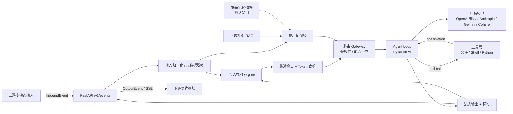

# OmniNexus Agent

**本地优先的 LLM Agent 核心（Local-first LLM Agent Core）**

OmniNexus Agent 接收上游多模态输入事件，完成模型路由、提示词渲染、上下文组装、**Agent Loop
（推理 → 工具 → 观察 → 再推理）**、可选联网检索，输出带 `emotion / type / intent` 标签的标准化事件。
它可独立运行，不依赖上游或下游模块；所有对话、提示词、引用和设置默认保存在本机 SQLite。

> **Drop-in 兼容**：模块 ID 仍是 `omninexus`，端口仍是 `8102`，`/v1/events`、`/v1/providers`、
> `/v1/prompts/profiles`、`/v1/healthz` 与 SSE 旧帧语义全部保持不变；Agent 只新增 `tool` 帧，
> 未知帧按既有约定被忽略，下游与启动器无需改动。

---

## 当前范围（v0.2）

外部记忆管线协作已取消，不属于本期交付：

- **正式记忆机制**：本地对话存档 + Token 预算内的最近对话窗口，按正式功能验收。
- **外部记忆管线**：仅作为 **Reserved for future use** 的插件接口保留；默认禁用，健康探测固定
  返回 `unavailable`，对主流程零影响。契约冻结、适配器与 mock 验证保留，后续不得删除。
- **提示词**：默认系统提示词为空。仓库**不包含任何正式人设或测试人格**；产品完成后通过提示词
  API / 页面统一填写。
- **Agent 工具**：文件读写（锁定在 `{data_dir}/omninexus/agent-workspace`）、受限 Shell、
  Python 代码执行；**不是**容器级沙箱，信任边界等于模型层进程权限（与 `manifest.json`
  的 `permissions` 一致）。

## 功能

| 能力 | 实现 |
| --- | --- |
| Agent Loop | Pydantic AI 驱动「推理 → 工具调用 → 观察 → 再推理」，`agent.max_steps` 预算内收敛；`tool` 帧透传，工具轨迹随存档保存 |
| 内置工具 | `file_read` / `file_write` / `file_list`（工作区锁）、`shell`（allowlist）、`python_code`（独立进程） |
| 多厂商 / 多模型 | 16 家云端厂商 + Ollama、LM Studio、vLLM、llama.cpp；注册表可编辑 |
| 运行时切换 | 会话级切换 API 与页面；存档为厂商无关消息，切换后延续上下文 |
| 故障降级 | 重试 → 同模型回退链 → 可配置模型重路由；SSE 中断保留部分答案 |
| 模型调用 | Pydantic AI 统一适配四家原生 SDK 与 OpenAI 兼容端点；流式 SSE、指数退避、进程内令牌桶限流 |
| 提示词 | 配置档案、不可变版本、激活/回滚/重置、Jinja2 沙箱变量注入；模型无关 |
| 提示词 UI 接口 | 读取、创建、保存新版本、激活版本、重置、删除、预览 |
| 联网搜索 | Tavily / Brave / SearXNG / DuckDuckGo / 自定义源；RAG + 引用溯源 |
| 多模态协商 | 模型能力表；缺视觉能力时自动路由视觉模型，否则带说明降级为文字 |
| 对话存档 | SQLite 持久化、历史、标题、导出 JSON/Markdown、删除、上下文裁剪 |
| 情感 / 类型 / 意图标签 | 本地确定性分类器，逐帧随输出事件下发 |
| 隐私 | 数据本地；密钥只读环境变量；日志脱敏；搜索只发送当前查询 |
| 离线演示 | 可选 `echo` 诊断模型，零密钥跑通完整链路（默认关闭） |

## 快速开始

要求：**Python 3.11+**。以下命令在仓库根目录执行。

### Windows PowerShell

```powershell
git clone https://github.com/zhipianxiaokonglong/OmniNexus.git
cd OmniNexus
py -3.13 -m venv .venv
.\.venv\Scripts\Activate.ps1
python -m pip install -e ".[dev]"
Copy-Item .env.example .env
# 编辑 .env，至少填入一个厂商密钥，例如 OPENAI_API_KEY=...
python -m omninexus
```

### Linux / macOS

```bash
git clone https://github.com/zhipianxiaokonglong/OmniNexus.git
cd OmniNexus
python3 -m venv .venv
. .venv/bin/activate
pip install -e ".[dev]"
cp .env.example .env
# 编辑 .env
python -m omninexus
```

打开 <http://127.0.0.1:8000>，API 文档在 <http://127.0.0.1:8000/docs>。

### 零密钥离线验证

```powershell
$env:OMNI_ENABLE_ECHO = "1"
python -m omninexus
```

页面选择 **Offline diagnostic echo**，或调用 API 时指定 `metadata.model = "echo:echo"`。该模型只回显
输入并说明未调用外部模型，用于验证“输入 → 处理 → 带标签输出”，**不是产品人设**。

```powershell
$body = @{
  event_id = [guid]::NewGuid().ToString()
  parts = @(@{ modality = "text"; content = "你好，介绍一下你自己" })
  metadata = @{ model = "echo:echo" }
} | ConvertTo-Json -Depth 6

Invoke-RestMethod -Method Post -Uri http://127.0.0.1:8000/v1/events `
  -ContentType "application/json" -Body $body | ConvertTo-Json -Depth 6
```

输出（字段严格符合下游契约）：

```json
{
  "event_id": "…",
  "session_id": "…",
  "content": "…",
  "stream": false,
  "tags": { "emotion": "neutral", "type": "text", "intent": "reply" }
}
```

流式调用加 `Accept: text/event-stream`（或 `?stream=1`）。SSE 帧语义见
[API 契约](docs/api.md#sse-语义)。

## 架构



详细设计见 [架构说明](docs/architecture.md)。

## 支持的厂商

OpenAI、Anthropic、Google Gemini、Mistral、xAI、Cohere、DeepSeek、阿里通义千问（百炼）、
字节豆包（火山方舟）、智谱 GLM、月之暗面 Kimi、百度文心千帆、讯飞星火、腾讯混元、MiniMax、
OpenRouter，以及本地部署类 Ollama、LM Studio、vLLM、llama.cpp。

模型调用由 Pydantic AI 统一适配：OpenAI 兼容端点走 `OpenAIChatModel`，Anthropic / Gemini /
Cohere 各走原生 SDK，四家都原生支持工具调用（tool call），这也是 Agent Loop 的基础能力。

OmniNexus **只推荐厂商与提供适配，不提供密钥或账户（BYOK）**。完整清单、Base URL、
环境变量与能力说明见 [厂商接入](docs/providers.md)。

## 隐私承诺

- 对话、提示词、引用、标签保存在本机 `data/omninexus.db`；不上传到 OmniNexus 的任何服务。
- API 密钥仅从本机环境变量读取；不接受密钥上传接口、不写数据库、不写日志、不出现在 API 响应。
- 存档支持查看、导出（JSON/Markdown）、删除。
- 联网搜索只发送当前用户查询及 `top_k`，不携带历史、会话 ID 或系统提示词。
- 日志只记录方法、路径、状态码、耗时、事件/会话 ID 与模型名，不记录对话内容；内置常见密钥模式
  与已加载密钥脱敏。
- `.env`、`data/`、日志均被 `.gitignore` 排除。

详见 [隐私与安全](docs/privacy-security.md)。

## 测试与验收

```powershell
python -m pytest -q
python -m ruff check src tests
python -m pytest --cov=omninexus --cov-report=term-missing
```

90 个自动化测试覆盖：多模型切换与上下文延续、重试/回退、限流、超时、能力协商、SSE 契约、
提示词版本化、存档导出/删除、搜索隐私、密钥脱敏、保留记忆插件的禁用/超时/故障零影响等。
Agent 测试覆盖工具循环、`tool` 帧、工具轨迹持久化、步数预算、沙箱逃逸拒绝与多模态历史转换。
完整矩阵、故障注入与根因分析见 [测试报告](docs/test-report.md)。

## 文档索引

| 文档 | 内容 |
| --- | --- |
| [架构说明](docs/architecture.md) | 组件、时序、存储结构、设计决策 |
| [Agent Loop](docs/agent-loop.md) | 循环语义、工具沙箱、SSE 新增帧、配置与限制 |
| [API 契约](docs/api.md) | 输入/输出事件、SSE、全部 HTTP 接口、错误码 |
| [提示词接口](docs/prompt-api.md) | 配置/版本/变量/重置语义与 UI 对接 |
| [厂商接入](docs/providers.md) | 推荐清单、Base URL、环境变量、能力与本地模型 |
| [降级方案](docs/degradation.md) | 故障矩阵、重试/回退、多模态、上下文裁剪 |
| [保留记忆接口](docs/memory-reserved.md) | Reserved 契约 v1.0、插件、健康探测、错误码 |
| [隐私与安全](docs/privacy-security.md) | 数据流、密钥、日志、威胁模型 |
| [用户文档](docs/user-guide.md) | 安装、配置、页面使用、故障排查 |
| [开发文档](docs/development.md) | 目录、扩展厂商、测试、发布清单 |
| [测试报告](docs/test-report.md) | 用例、故障注入、根因分析、限制 |
| [验收对照](docs/acceptance.md) | 需求 → 证据映射 |

## 常用命令

```powershell
python -m omninexus                     # 启动（读取 config/default.yaml）
python -m omninexus --port 9000         # 覆盖端口
python -m omninexus --config path.yaml  # 指定配置
python -m pytest -q                     # 测试
python -m ruff check src tests          # 静态检查
docker compose up --build               # 容器（仅发布到 127.0.0.1）
```

## 已知边界

- 本服务默认仅监听 `127.0.0.1`，**没有内建多用户认证**。若改为对外监听，必须在外层加认证、TLS
  与访问控制；UI 的提示词接口具有写权限。
- 真实厂商 API 需要用户自己的密钥；CI 与仓库测试不调用真实付费接口。
- 模型 ID、上下文窗口与多模态能力会随厂商变化，可在 `config/default.yaml` 中修改；以厂商文档为准。
- 流式响应在**首个 Token 之前**失败会透明重试/回退；已输出部分内容后失败不会重复拼接另一模型
  的答案，而是保留部分内容并发送 `warning`。
- 外部记忆管线仅为保留接口，**本期不参与运行路径**。

## License

[MIT](LICENSE)
