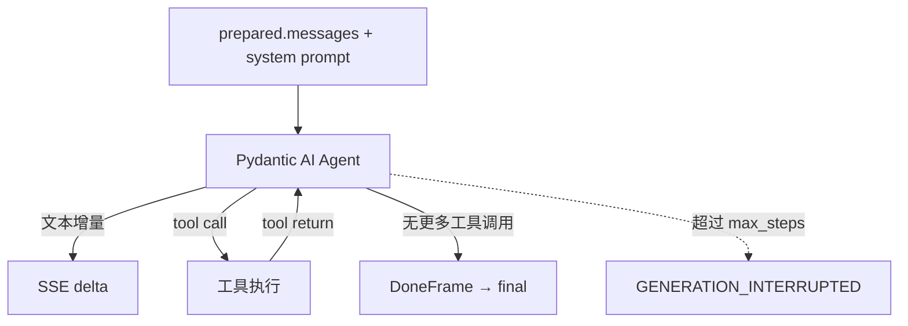

# Agent Loop

OmniNexus Agent 在**模型层**把单轮 LLM 调用扩展为「推理 → 工具调用 → 观察 → 再推理」的循环。
能力边界在 `src/omninexus/agent/`，不改变上游输入与下游输出契约。

## 1. 为什么在这一层

三层职责固定为「输入 8101 / 模型 8102 / 输出 8103」。Agent 需要直接驱动模型并消费模型的工具
调用意图，因此只能放在模型层（8102）。上游仍只发 `InboundEvent`，下游仍只收 `OutputEvent`。

## 2. 循环结构



- 内核：`pydantic_ai.Agent.run_stream_events()`，单次调用内部完成一次完整循环。
- 预算：`agent.max_steps` 映射到 `UsageLimits(request_limit=...)`；一轮 = 一次模型请求。
- 降级：候选链逐个尝试（每个候选按 `gateway.max_retries` 重试可重试错误），成功后记录
  `plan.selected_model / selected_provider / fallback_used / attempts`，与旧 gateway 语义对齐。
- 部分输出保护：一旦已经向客户端发过 `delta`，后续错误不再切换候选（避免重放），改为保留
  部分答案 + `warning` 帧。

## 3. 工具与沙箱

| 工具 | 行为 | 边界 |
| --- | --- | --- |
| `file_read` | 读文本文件（超限截断） | 路径必须落在工作区内 |
| `file_write` | 写/覆盖文件，自动建父目录 | 同上 |
| `file_list` | 列目录（目录名带 `/`） | 同上 |
| `shell` | 在 工作区 cwd 执行命令 | 程序必须在 `agent.shell_allow`；`git` 再受 `agent.git_allow` 限制 |
| `python_code` | 写临时脚本后以独立进程执行 | 超时 + 输出上限，cwd = 工作区 |

工作区根：`{data_dir}/omninexus/{agent.workspace_dir}`，默认 `agent-workspace`。

路径解析先 `resolve()` 再做父子关系判定，`..` 与符号链接逃逸都会被拒绝；子进程在 Windows 上带
`CREATE_NO_WINDOW`，输出按 `agent.max_output_chars` 截断，整体受 `agent.timeout_s` 约束。

**诚实声明**：这是**受限 Shell**，不是容器级沙箱。信任边界等于模型层进程的操作系统权限，与
`manifest.json` 的 `permissions` 一致。需要更强隔离时应在外层加容器/虚拟机。

## 4. SSE 帧

旧帧（`meta` / `route` / `delta` / `citations` / `warning` / `error` / `final`）语义不变；
新增 `tool` 帧，下游忽略未知帧即可：

```text
event: tool
data: {"event_id":"…","session_id":"…","tool":{"name":"file_write","arguments":"{\"path\":\"a.txt\",…}","call_id":"call-1","status":"started"}}

event: tool
data: {"event_id":"…","session_id":"…","tool":{"name":"file_write","call_id":"call-1","status":"finished","output":"已写入 a.txt（1 字节）"}}
```

`status` 取值 `started` / `finished` / `failed`；`call_id` 用于把开始与结束配对。
`meta.agent` 下新增 `enabled / max_steps / tools` 三个字段，仍属同一 `meta` 帧。

工具调用轨迹（名称、参数、call_id）会写入该助手消息的 `metadata.tool_trace`，可随会话导出。

## 5. 配置

```yaml
agent:
  enabled: true
  max_steps: 10
  workspace_dir: agent-workspace
  tools: { file: true, shell: true, python: true }
  shell_allow: [dir, ls, cat, type, echo, pwd, grep, find, head, tail, wc, tree, python, py, node, git, mkdir, touch]
  git_allow: [status, log, diff, show, ls-files, remote, branch]
  timeout_s: 30
  max_output_chars: 20000
```

关闭 `agent.enabled` 后工具列表为空，模型退化为单轮问答——即旧行为。

## 6. 限制

- 没有人工批准（human-in-the-loop）反向通道：工具一旦被模型选中即执行。需要确认交互时要
  由下游提供批准 UI 与回调（v2 计划）。
- 搜索服务未进入工具集，联网检索仍走 `/v1/events` 的既有 RAG 路径。
- 工具输出直接回灌给模型，恶意文件内容可能构成提示注入；工作区限定降低了影响面但不消除。
