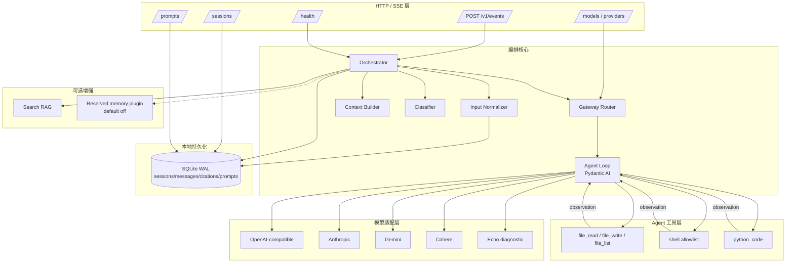
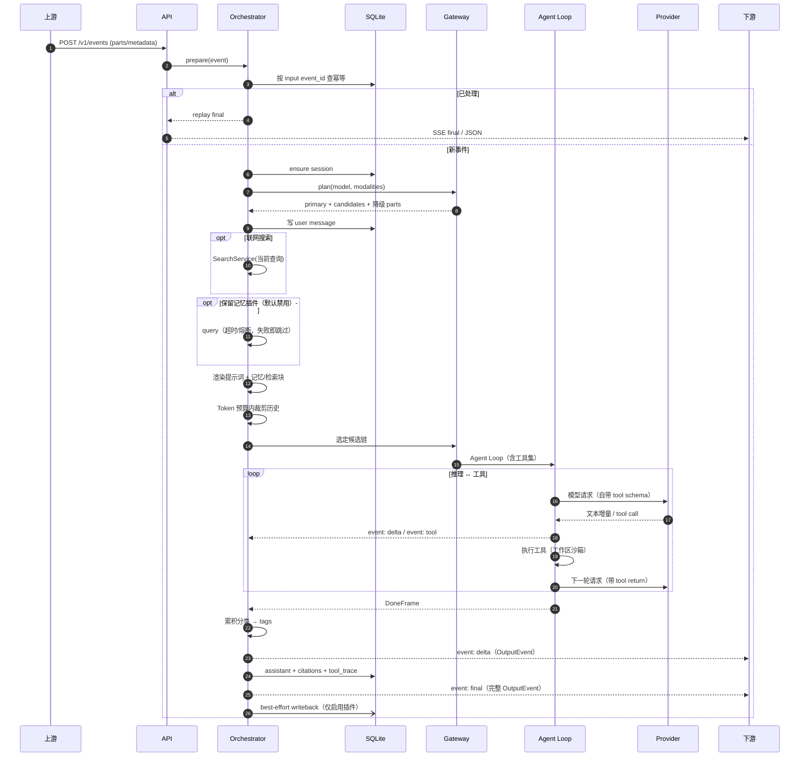

# 架构说明

## 1. 设计目标

1. **独立可运行**：只依赖 Python 与公开 PyPI 包，不依赖上游多模态模块或下游表达模块。
2. **本地优先**：对话、提示词、引用、标签默认只写本机 SQLite；不引入云端数据库或遥测。
3. **BYOK**：密钥只从环境变量读取，不进入 HTTP 请求、数据库、日志或仓库。
4. **契约稳定**：下游事件、记忆查询 JSON、提示词接口均按版本冻结；内部实现可替换。
5. **故障隔离**：任一增强能力（搜索、保留记忆、某个厂商）失效时，主对话链路仍可完成。

## 2. 组件



| 模块 | 路径 | 职责 |
| --- | --- | --- |
| API / SSE | `src/omninexus/api/` | 路由、请求校验、SSE 编码、错误映射、请求 ID |
| 编排 | `src/omninexus/orchestrator.py` | 一次对话回合的状态机、标签、持久化、流式帧 |
| 路由 | `src/omninexus/gateway/router.py` | 能力协商、候选链、降级 parts（不再做网络调用） |
| Agent Loop | `src/omninexus/agent/engine.py` | Pydantic AI 循环、模型构造、错误映射、重试/限流/降级 |
| Agent 工具 | `src/omninexus/agent/tools.py` + `sandbox.py` | 文件/Shell/代码执行与工作区沙箱 |
| 提示词 | `src/omninexus/prompts/manager.py` | 档案、不可变版本、沙箱渲染、重置 |
| 会话 | `src/omninexus/sessions/service.py` | 会话生命周期、导出、最近窗口裁剪 |
| 存储 | `src/omninexus/storage/database.py` | SQLite schema、事务、WAL、线程执行 |
| 分类 | `src/omninexus/core/classifier.py` | 本地情感/类型/意图判定 |
| 搜索 | `src/omninexus/search/service.py` | 可配置搜索源、查询最小化、引用 |
| 保留记忆 | `src/omninexus/memory/` | 默认禁用插件、冻结契约、健康/熔断 |
| 配置 | `src/omninexus/config.py` | YAML + 环境变量、模型注册表、BYOK 映射 |
| 日志 | `src/omninexus/logging.py` | JSON/文本日志、密钥脱敏、文件可选 |

## 3. 一次回合的时序



`prepare` 在返回 `StreamingResponse` 之前完成，因此未知模型、无可用厂商、非法输入等错误仍能返回
正常 HTTP 4xx/5xx JSON，而不是半截 SSE。

## 4. 存储结构

SQLite，默认 `data/omninexus.db`，WAL 模式，外键开启。

```sql
sessions(id, title, model, prompt_profile, web_search,
         created_at, updated_at, metadata)
messages(id, session_id→sessions, role, content, parts JSON,
         created_at, token_estimate, metadata JSON, source_event_id)
citations(id, event_id, session_id→sessions, url, title, snippet,
          rank, source, created_at)
prompt_profiles(id, name UNIQUE, description, builtin, active_version,
                created_at, updated_at)
prompt_versions(id, profile_id→prompt_profiles, version, system_template,
                change_note, content_hash, created_at,
                UNIQUE(profile_id, version))
```

- `messages.parts` 保存规范化的文本/图片/音频/文件片段；图片以 data URL 存储，导出时完整保留。
- `messages.source_event_id` 唯一索引用于**输入幂等**：同一 `event_id` 重投返回同一输出事件。
- `metadata` 只保存白名单字段（模型、标签、用量、能力原因等），不保存上游原始 metadata。
- 删除会话触发 `ON DELETE CASCADE`，同时删除消息与引用。
- 每次操作在线程池中打开连接；写操作由进程内 `asyncio.Lock` 串行化，读操作可并发。

## 5. 上下文窗口

`ContextBuilder` 采用保守估算：CJK 字符约 1 Token，其他字符约 4 字符/Token；图片按 850 Token 估算。

```text
可用预算 = 模型上下文窗口 - 最大输出 Token - 安全余量(512)
```

1. 系统提示词（含检索/记忆块）先占用预算。
2. 从最新消息向旧消息加入，直到预算用尽；丢弃更旧消息。
3. **当前用户消息永远保留**；如超预算则截断文本，图片至少保留最后一张。
4. 回退到上下文更小的模型时，编排层再按该模型预算裁剪一次。
5. 被丢弃的消息仍完整保存在存档中，可通过导出查看。

这是 v1.1 的**正式记忆方案**，不依赖外部管线。

## 6. 路由与能力协商

`Gateway.plan(model_id, parts)`（只做决策，不做网络调用）：

1. 读取模型注册表，构造候选链：主模型 → `fallbacks` → 全局 `fallback_models`。
2. 过滤未配置的厂商（缺密钥/禁用）；若整条链都不可用，但存在其他已配置模型，则重路由到该模型，
   标记 `requested_unavailable`。
3. 检查输入模态：若主模型不支持图片，优先在同链中寻找支持视觉的模型（`capability_route`）；
   找不到则把图片/音频/文件转成带说明的文字（`capability_degraded`），对话不失败。
4. 执行交给 Agent Loop；当具体候选不支持图片时（例如视觉模型失败后回退到文本模型），
   Agent Loop 在发送前把图片降级为文字占位。
5. Agent Loop 按候选链尝试；每个候选内部先按 `max_retries` 重试，再切换下一候选。

详细策略与流式中断语义见 [降级方案](degradation.md)，工具与循环见 [Agent Loop](agent-loop.md)。

## 7. 标签

标签在本地、确定性生成，随每个 `delta` 与 `final` 事件下发：

- `emotion`：joy / sadness / anger / fear / surprise / confusion / frustration / gratitude / neutral
- `type`：text / code / list / table / json / mixed
- `intent`：reply / tool / linkage
  - `tool`：本轮实际使用了联网搜索结果
  - `linkage`：本轮实际注入了保留记忆插件的条目
  - `reply`：普通回复

标签是**内容标签**而非安全分类；不替代内容审核。

## 8. 并发与性能

- FastAPI + uvicorn，单进程异步 I/O；SQLite 写入串行但很快。
- 每个厂商共享一个 `httpx.AsyncClient`，连接复用；请求级超时。
- 限流为**进程内令牌桶**（每厂商），多进程/多实例部署时需外部限流。
- 内存中的健康探测/熔断状态只影响保留记忆插件，不进入正式路径。
- 大图片以 base64 存 SQLite，建议单图 < 8 MB；生产部署可替换为本地文件存储适配器。

## 9. 关键设计决策

| 决策 | 理由 |
| --- | --- |
| 提示词与模型解耦 | 同一条消息可在不同厂商间切换；提示词版本独立于模型 ID |
| Agent Loop 放在模型层 | 只有模型层能直接消费模型的 tool call；上游/下游契约保持不变 |
| 内核选 Pydantic AI | 原生支持四家厂商 tool call + OpenAI 兼容端点，类型安全工具参数，内置 MCP 客户端为未来膨胀留口 |
| 工具沙箱是受限 Shell 而非容器 | 与 manifest permissions 对齐；容器级隔离留给外层部署 |
| RAG 仍走预检索 | 检索结果进入 system prompt 且引用可控；搜索未进入工具集，避免一次循环里多次联网 |
| 最终帧 `stream=false` | 下游可以“替换”而不是“追加”，避免重复正文；增量帧 `stream=true` |
| 默认无系统提示词 | 不在仓库内置人设；正式人设由产品完成后填写 |
| 保留记忆接口但不接入 | 明确取消协作；存档 + 最近窗口是正式路径，插件保留供未来使用 |
| 本地无认证 | 默认只监听回环地址；对外部署必须加外层认证 |

## 10. 扩展点

- **新厂商**：在 `providers` 中增加 OpenAI-compatible 配置即可；需要原生 SDK 时在
  `agent/engine.py::_build_model` 增加分支。
- **新工具**：在 `agent/tools.py` 加函数并登记到 `AgentTools.tools()`；路径/子进程必须走
  `Workspace` 沙箱。
- **新模型**：在 `models` 中增加条目与 `fallbacks`；无需改代码。
- **新分类标签**：修改 `classifier.py` 与枚举，并更新契约版本。
- **新搜索源**：实现 `SearchProvider` 并注册。
- **记忆管线**：实现 `MemoryPlugin` 或使用 `HttpMemoryPlugin`，默认禁用。
- **存储后端**：`Database` 与 `SessionService` 隔离，可替换为其他本地存储。
